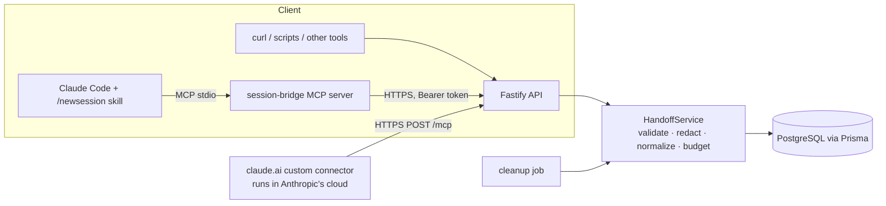

# Session Bridge

Passwordless, API-first handoff store for continuing long AI coding sessions in a **fresh conversation**.

A developer finishes (or abandons) a long Claude session, runs `/newsession`, and Claude saves a compact, structured
summary: objective, decisions, completed work, current state, failed attempts, constraints, next action. Session
Bridge returns a **handoff ID** and a separate **retrieval token**. In a new conversation, Claude fetches the context
and resumes the unfinished work instead of re-deriving it.

- Independent product. It is **not** part of Spinekit.
- No accounts, no OAuth, no LLM API key, no Redis, no object storage. Storing and retrieving memory never calls an LLM.
- A new session means a fresh context window, **not** free or unlimited usage. Session Bridge makes no fixed token
  savings promise; see [Measuring](#measuring-token-efficiency).

> **Project status (read this).** This snapshot was produced in an offline sandbox without npm access.
> Executed there: 95 dependency-free unit tests (memory engine, redaction, credentials, retention, rate limiting,
> auth flow, service logic incl. cleanup, MCP tool handlers, the in-process hosted-MCP tool flow, skill file), run through a small Vitest-API shim, plus a strict
> `tsc` pass on everything that resolves offline.
> **Not executed:** anything needing installed packages: the Fastify app and its injection tests, zod schemas,
> Prisma repository and PostgreSQL integration tests, the MCP SDK wiring (stdio and the hosted `/mcp` endpoint), ESLint/Prettier, a real Vitest run. Run
> `npm install && npm run typecheck && npm test` before relying on it. Dependency versions were chosen from
> documentation read on 2026-11-03 and need `npm outdated` confirmation.

## Architecture



| Path | Purpose |
| --- | --- |
| `apps/api` | Fastify API: REST routes, hosted MCP endpoint `/mcp`, rate limiting/guard, services, repositories, cleanup, admin CLI |
| `packages/shared` | Zod schemas, memory engine (normalize, dedupe, budget), redaction, resume builder |
| `packages/mcp-server` | MCP server (official TypeScript SDK, stdio): `create_handoff`, `resume_handoff`, `delete_handoff`, `search_archive` |
| `packages/skill/newsession` | Claude Code skill providing `/newsession` |
| `prisma` | Schema and SQL migrations |
| `tests` | Vitest suites |

Stack: Node.js ≥ 22.12, TypeScript (strict), Fastify 5, Zod 3, PostgreSQL + Prisma 7 (`@prisma/adapter-pg`), MCP
TypeScript SDK 1.x, Vitest, ESLint, Prettier, Docker Compose, npm workspaces.

## Quick start

Prerequisites: Node ≥ 22.12, npm, Docker (for local PostgreSQL).

```bash
cp .env.example .env                       # set TOKEN_PEPPER (openssl rand -base64 48)
npm install                                # commit the generated package-lock.json
npm run db:up                              # PostgreSQL 17 on 127.0.0.1:5432 (also creates session_bridge_test)
npm run db:generate                        # Prisma client -> apps/api/src/generated (git-ignored)
npm run db:migrate:deploy                  # apply prisma/migrations
npm run dev                                # API on http://127.0.0.1:3000
curl -s http://127.0.0.1:3000/health       # {"status":"ok"}
```

Commands: `npm test`, `npm run typecheck`, `npm run lint`, `npm run format`, `npm run build`, `npm start`,
`npm run cleanup` (one cleanup pass; in production use `npm run cleanup:prod`, which runs the compiled script), `npx tsx apps/api/src/scripts/admin.ts stats|revoke <id>` (compiled: `node apps/api/dist/scripts/admin.js ...`).

Migrations: `npm run db:migrate:dev` (creates/applies migrations in development), `npm run db:migrate:deploy`
(production). The initial migration was written by hand to match `schema.prisma`; run `npm run db:migrate:dev` once
and confirm Prisma reports no drift.

DB integration tests: `DATABASE_URL=$DATABASE_URL_TEST npx prisma migrate deploy` then
`DATABASE_URL_TEST=... npm test` (skipped when unset).

## Configuration

All configuration is environment-based and validated at startup (errors name variables, never values). See
`.env.example` for every variable. Key ones:

| Variable | Default | Meaning |
| --- | --- | --- |
| `DATABASE_URL` | – | PostgreSQL URL (required in production) |
| `TOKEN_PEPPER` | – (required, ≥ 32 chars) | Key for the HMAC that hashes retrieval tokens. Rotating it invalidates all tokens. Placeholder rejected in production |
| `TRUST_PROXY` | `false` | Set `true`/hop count/CIDRs behind a proxy so client IP and `https` are detected |
| `REQUIRE_HTTPS` | `true` in production | Non-https requests get 426 (`/health` exempt) |
| `MAX_BODY_BYTES` | 262144 | HTTP body cap (413 above) |
| `MEMORY_BUDGET_BYTES` | 65536 | Stored memory budget; larger payloads are reduced deterministically and flagged |
| `DEFAULT_RETENTION` | `30d` | `24h`, `30d` or `90d` (persistent can never be the default) |
| `ALLOW_PERSISTENT_RETENTION` | `true` | Allow explicit `persistent` |
| `PERSISTENT_INACTIVITY_DAYS` | 365 | Persistent handoffs unused this long are purged (0 disables) |
| `TOMBSTONE_DAYS` | 7 | Grace period during which repeated DELETEs stay idempotent |
| `CLEANUP_INTERVAL_MINUTES` | 60 | In-process cleanup cadence (0 = run `npm run cleanup:prod` from cron) |
| `REDACT_SECRETS` | `true` | Best-effort secret redaction on create |
| `MCP_ACCESS_TOKEN` | – (optional, ≥ 24 chars) | Shared key required on `POST /mcp` (`X-Session-Bridge-Key` or `Authorization: Bearer`). Recommended for a personal deployment |
| `DB_POOL_MAX` | 10 | pg pool size per instance |

## API

Base URL examples use `$BASE`. All bodies are JSON. Authorization for everything except creation and `/health` is
`Authorization: Bearer <retrieval_token>`; tokens are never accepted in URLs. Responses carry `Cache-Control: no-store`.
Errors: `{"error":{"code":"...","message":"...","details":[...]}}`.

### `POST /v1/handoffs`

```bash
curl -sS -X POST "$BASE/v1/handoffs" -H 'content-type: application/json' -d '{
  "project": {"name": "Example Project", "stack": ["Next.js", "TypeScript", "PostgreSQL"]},
  "objective": "Fix authentication",
  "decisions": ["Use NextAuth with the Prisma adapter"],
  "failed_attempts": [{"attempt": "Changed cookie domain", "result": "No effect"}],
  "constraints": ["No new paid services"],
  "relevant_files": [{"path": "src/auth.ts", "symbols": ["callbacks"]}],
  "next_action": "Inspect the authentication callback",
  "retention": "30d"
}'
```

```json
{
  "handoff_id": "hs_example123456789",
  "retrieval_token": "sbt_<43 random characters, shown once>",
  "expires_at": "2026-12-02T10:00:00.000Z",
  "status": "active",
  "retention": "30d",
  "payload_bytes": 412,
  "truncated": false,
  "warnings": []
}
```

(Example values are illustrative, not real credentials.) Fields: `project{name,stack[]}`, `objective`, `next_action`
(required); optional lists `requirements`, `decisions`, `completed`, `current_state`, `constraints`, `errors`,
`open_questions`, `assumptions` (unverified beliefs, kept separate from facts); `failed_attempts` (strings or
`{attempt,result}`); `relevant_files` (strings or `{path,symbols[],note}`); `retention` (`24h|30d|90d|persistent`).
Unknown fields are rejected. The token is returned **only here**; the server stores just its HMAC.

### `GET /v1/handoffs/:id`

```bash
curl -sS "$BASE/v1/handoffs/$ID" -H "Authorization: Bearer $TOKEN"
```

Returns `{handoff_id,status,retention,created_at,expires_at,schema_version,payload_bytes,approx_tokens,memory}`.

### `POST /v1/handoffs/:id/resume`

```bash
curl -sS -X POST "$BASE/v1/handoffs/$ID/resume" -H "Authorization: Bearer $TOKEN" \
  -H 'content-type: application/json' -d '{"max_tokens": 4000, "format": "text"}'
```

Body optional (send `{}` or nothing). `format`: `text` (default), `json`, `both`. Returns
`{handoff_id,text,approx_tokens,token_estimate,truncated,omitted,over_budget,archive:{available:false,reference:null}}`.
`max_tokens` (200–100000) applies a deterministic reduction and reports what was dropped.

### `DELETE /v1/handoffs/:id`

Scrubs the memory immediately and returns `{handoff_id,status:"deleted"}`. Repeating the call with the same token
succeeds until the tombstone is purged (`TOMBSTONE_DAYS`), after which the id is simply unknown (404).
Do not send a `Content-Type` header without a body.

### `GET /health`

`200 {"status":"ok"}` or `503 {"status":"unavailable"}` (database unreachable). Nothing else is exposed.

| Status | Meaning |
| --- | --- |
| 400 / 413 / 415 | validation failed / body too large / not JSON |
| 401 | missing or malformed `Authorization: Bearer` header |
| 404 | unknown id, wrong token or deleted handoff: **deliberately indistinguishable** |
| 410 | valid token, but the handoff expired (`expired`) or was revoked (`revoked`) |
| 426 | https required |
| 429 | rate limited; honour `Retry-After` |
| 503 | server at its concurrency limit (`Retry-After: 1`) |

## Access model and credential security

1. `POST /v1/handoffs` needs no account. It returns a public **handoff ID** (`hs_` + 96 random bits) and a
   **retrieval token** (`sbt_` + 256 random bits).
2. Only `HMAC-SHA256(TOKEN_PEPPER, token)` is stored. Verification is constant-time. The token is never logged.
3. The ID never authorizes anything. Wrong token, unknown ID and deleted handoff produce the identical 404; a dummy
   hash comparison keeps timing similar. A valid token on an expired/revoked handoff gets 410.
4. Anyone holding the token can read or delete that one handoff, and nothing else. Treat it like a password.
5. Redaction (API and MCP client) removes common key/token/credential shapes before storage; **detection is
   imperfect** and will miss secrets. Never rely on it; keep secrets out of conversations you hand off.
6. Production requires https, rejects the placeholder pepper, logs no bodies, and sends `no-store`/`nosniff`/HSTS.

See [SECURITY.md](SECURITY.md).

## Retention and cleanup

| Policy | Expires |
| --- | --- |
| `24h`, `30d` (default), `90d` | creation time + duration, stored in UTC |
| `persistent` | never by time; kept until deleted, **or purged after `PERSISTENT_INACTIVITY_DAYS` (default 365) without access** |

The server validates the policy; clients cannot supply arbitrary expiry values. Persistent must be requested
explicitly. Expired handoffs are refused at retrieval time (410) and physically removed by cleanup. Cleanup is one
atomic, idempotent transaction that removes (a) expired rows, (b) deleted/revoked tombstones older than
`TOMBSTONE_DAYS`, (c) inactive persistent rows. It runs in-process every `CLEANUP_INTERVAL_MINUTES` and via
`npm run cleanup:prod` (cron/serverless). Full conversation archives do not exist; nothing else is stored.

## Rate limits and resource controls

All values are environment-configurable and enforced in memory **per server instance** (running N instances
multiplies each limit by N; swap `FixedWindowLimiter` for a shared store only if you need exact global limits).
Fixed windows allow up to 2x bursts at window boundaries. There are no accounts, so creation (which has no
credential yet) is limited per IP and globally rather than "per credential".

| Layer | Default |
| --- | --- |
| All requests per IP (not `/health`) | 300 / min |
| Create per IP / create globally | 10 / min, 600 / min |
| Read, resume, delete **per handoff** (counted only after the token verifies) | 60, 30, 10 / min |
| Invalid credentials per IP+handoff / per IP | 10, 50 per 15 min (keyed by IP, so an attacker elsewhere cannot lock out a legitimate user) |
| Hosted MCP `/mcp`: requests per IP / creates per IP (claude.ai shares a few IPs) | 1200 / min, 60 / min |
| In-flight requests | 200 (then 503) |

Other controls: body cap, per-field length/array caps, memory budget with deterministic reduction (always reported,
never silently claiming full history), connection/request timeouts, bounded limiter key tables, pooled DB access.
No arbitrary user or handoff count limits exist in code; capacity is set by your infrastructure.
Behind a proxy set `TRUST_PROXY`, otherwise every client shares the proxy's IP.

## MCP server and skill

The MCP server (`packages/mcp-server`, stdio) exposes `create_handoff`, `resume_handoff`, `delete_handoff` and
`search_archive` (always returns `unsupported_operation`; archives are not implemented). It holds **no server
credential**: it only forwards what the model supplies. By default it also saves each new token in
`~/.session-bridge/tokens.json` (mode 0600) so the same machine needs only the ID; set
`SESSION_BRIDGE_TOKEN_STORE=off` to disable, `SESSION_BRIDGE_REVEAL_TOKEN=false` to keep the token out of the
conversation. Two ways to reach it: the local stdio server (Claude Code) and a **hosted, stateless Streamable HTTP endpoint
`POST /mcp`** on the API itself (claude.ai custom connectors). The hosted endpoint has no server credential either;
every call carries the handoff's own token as a tool argument, and it has no local token store. Set `MCP_ACCESS_TOKEN` to require a shared key on it.

**Website, no server:** [claude-ai-instructions.md](docs/integrations/claude-ai-instructions.md) defines `/newsession` with a
pasted handoff block. Setup per environment: [Claude Code](docs/integrations/claude-code.md) ·
[Claude.ai website](docs/integrations/claude-ai.md) (needs a public https URL). Skill install: `packages/skill/README.md`
(Claude Code only).

## Deployment (manual; nothing has been deployed)

1. Provision managed PostgreSQL. Keep `DB_POOL_MAX × instances` under its connection limit (use a pooler for many
   instances).
2. Set env: `NODE_ENV=production`, `DATABASE_URL`, a fresh `TOKEN_PEPPER` (store in your secret manager),
   `TRUST_PROXY` to match your platform, optional tuning from `.env.example`.
3. `npm ci && npm run build`, then `npx prisma migrate deploy` (run it as a release step, once).
4. Start `npm start` (`node apps/api/dist/server.js`); health check `GET /health`; terminate TLS at the platform.
   claude.ai connects from Anthropic's cloud, so the public https URL (`https://your-host/mcp`) is what you give it.
5. Back up the database; if you rotate `TOKEN_PEPPER`, all outstanding tokens stop working.

SIGTERM/SIGINT trigger graceful shutdown (drain, close pool; 10 s hard stop).

## Monitoring

Structured JSON logs (pino) with method, path (no query), IP, status, latency; no bodies or credentials. Watch 5xx,
429 and 503 rates, `/health`, DB pool saturation, and the `cleanup complete` log line, which reports purge counts and
storage metrics (`active`, `activePayloadBytes`, `expiredPending`, `tombstones`); also available on demand via
`admin.ts stats`.

## Measuring token efficiency

Session Bridge reports `payload_bytes` and `approx_tokens` (characters/4, an **approximation**, never an exact token
count). To judge value, compare your client's own reported input tokens and whether the task was completed for a
resumed session versus continuing the long one. The product does not measure task success automatically.

## Troubleshooting

| Symptom | Check |
| --- | --- |
| Startup: `Invalid environment configuration` | The named variable; `TOKEN_PEPPER` ≥ 32 chars, not the placeholder in production |
| Everything returns 426 | `REQUIRE_HTTPS` is on; set `TRUST_PROXY` so `X-Forwarded-Proto` is honoured |
| 429 for all users | Proxy IP shared: set `TRUST_PROXY`; or raise `RATE_LIMIT_IP_PER_MIN` |
| 401 on a correct token | Header must be `Authorization: Bearer sbt_...`; query-string tokens are ignored |
| 404 on a handoff you created | Wrong token, deleted, or purged after expiry (404 and 410 depend on cleanup timing) |
| `Cannot find module .../generated/prisma/client.js` | Run `npm run db:generate` |
| Connector says Connected but Claude never calls the tools | Enable the connector in that chat's tools menu; check server logs for `POST /mcp`; remove and re-add it (see docs/integrations/claude-ai.md) |
| MCP tools missing in Claude Code | `claude mcp list`, run `/mcp`, confirm the absolute path to `dist/index.js` and that `npm run build` ran |

## Known limitations

In-memory, per-instance rate limits · redaction misses secrets · tokens appear in the creating conversation's tool
output unless `SESSION_BRIDGE_REVEAL_TOKEN=false` · local token store is plaintext (permission-protected) · the hosted
`/mcp` endpoint is unverified against a live claude.ai connector, always shows the token in chat and needs a public https URL · archives and `search_archive` not implemented · no per-user quotas
(no accounts) · hand-written initial migration needs a drift check · versions unverified against live npm.

## License and contributing

MIT (see `LICENSE`): permissive, short, and trivially compatible with commercial use. Update the copyright holder
before publishing. See [CONTRIBUTING.md](CONTRIBUTING.md). Third-party repositories evaluated for reuse (none
integrated): [docs/repo-evaluation.md](docs/repo-evaluation.md).
